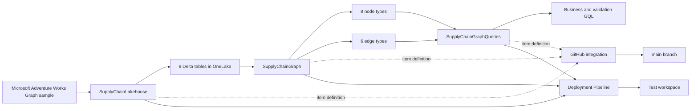
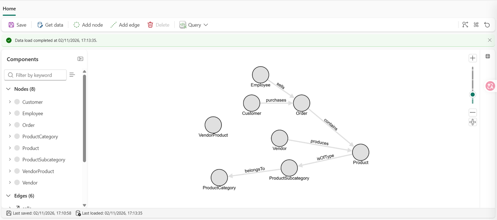
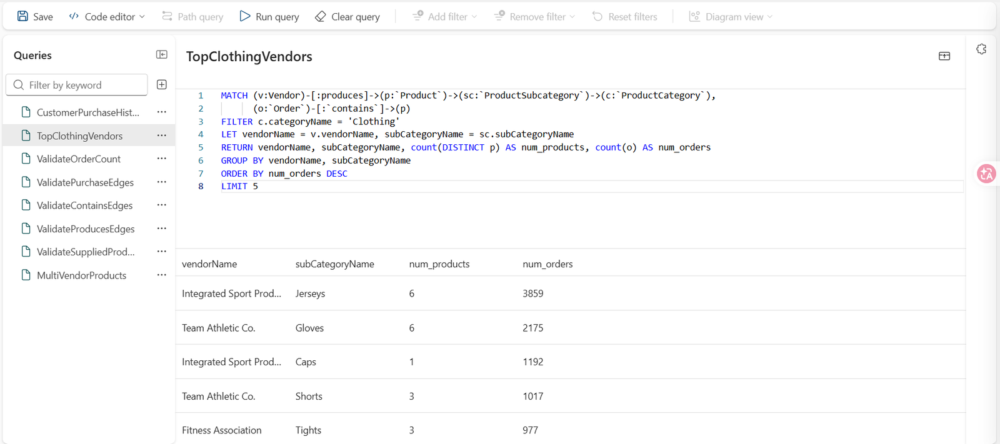

# Fabric Supply Chain Graph Analytics

[](https://www.microsoft.com/microsoft-fabric)
[](https://learn.microsoft.com/fabric/graph/overview)
[](https://learn.microsoft.com/fabric/graph/gql-language-guide)
[](LICENSE)

A Microsoft Fabric portfolio project demonstrating relationship-centric supply chain analysis with Fabric Graph, OneLake, GQL, Git integration, and controlled Development-to-Test deployment.

The solution models customers, sales-order lines, products, employees, categories, subcategories, vendors, and vendor-product source records as a property graph over Delta tables in OneLake.

## Business Objectives

The project answers relationship-oriented questions that are cumbersome to explore in a purely tabular model:

- Which products did a selected customer purchase?
- Which vendors supply products with the highest distinct-order activity in a selected category?
- Which products depend on multiple vendors?
- Are source rows represented by valid graph nodes and edges?
- How many line-level nodes and distinct business orders exist?
- Are graph endpoints complete and referentially valid?
- Can graph definitions and saved GQL queries be versioned in GitHub?
- Can reviewed changes be promoted safely from Development to Test?

## Architecture



## Microsoft Fabric Items

| Item | Type | Purpose |
|---|---|---|
| `SupplyChainLakehouse` | Lakehouse | Stores the eight Adventure Works Delta source tables in OneLake |
| `SupplyChainGraph` | Graph Model | Defines eight node types, six edge types, properties, keys, and Lakehouse mappings |
| `SupplyChainGraphQueries` | Graph QuerySet | Stores business and validation queries written in GQL |
| `Fabric Supply Chain Graph Analytics` | Deployment Pipeline | Promotes reviewed metadata changes from Development to Test |

## Environments

### Development

```text
Fabric Supply Chain Graph Analytics - Dev
```

### Test

```text
Fabric Supply Chain Graph Analytics - Test
```

The implemented deployment path is:

```text
Development → Test
```

Workspace access was validated with one project administrator and no additional users or groups.

## Source Data

The project uses Microsoft's Adventure Works dataset prepared for the Fabric Graph tutorial.

Validated source tables:

| Source table | Rows |
|---|---:|
| `adventureworks_customers` | 635 |
| `adventureworks_employees` | 17 |
| `adventureworks_orders` | 60,919 |
| `adventureworks_productcategories` | 4 |
| `adventureworks_products` | 295 |
| `adventureworks_productsubcategories` | 37 |
| `adventureworks_vendorproduct` | 460 |
| `adventureworks_vendors` | 104 |
| **Total** | **62,471** |

Validated key-quality results:

```text
Null graph keys: 0
Duplicate graph keys: 0
Duplicate Vendor-Product pairs: 0
```

The complete read-only validation is available in:

```text
docs/VALIDATION.sql
```

## Graph Model

### Node Types

| Node | Source table | Validated source grain or key |
|---|---|---|
| `Customer` | `adventureworks_customers` | `CustomerID_K` |
| `Employee` | `adventureworks_employees` | `EmployeeID_K` |
| `Order` | `adventureworks_orders` | `SalesOrderDetailID_K` |
| `ProductCategory` | `adventureworks_productcategories` | `CategoryID_K` |
| `Product` | `adventureworks_products` | `ProductID_K` |
| `ProductSubcategory` | `adventureworks_productsubcategories` | `SubcategoryID_K` |
| `VendorProduct` | `adventureworks_vendorproduct` | Source grain: `(VendorID_FK, ProductID_FK)` |
| `Vendor` | `adventureworks_vendors` | `VendorID_K` |

### Edge Types

| Edge | Relationship | Source table |
|---|---|---|
| `sells` | `Employee → Order` | `adventureworks_orders` |
| `purchases` | `Customer → Order` | `adventureworks_orders` |
| `contains` | `Order → Product` | `adventureworks_orders` |
| `isOfType` | `Product → ProductSubcategory` | `adventureworks_products` |
| `belongsTo` | `ProductSubcategory → ProductCategory` | `adventureworks_productsubcategories` |
| `produces` | `Vendor → Product` | `adventureworks_vendorproduct` |



## Order Node Grain

The Graph node labeled `Order` uses:

```text
SalesOrderDetailID_K
```

as its unique key.

The actual grain is therefore:

```text
One Order node = one sales-order detail line
```

The node does not represent one distinct sales-order header.

Validated grain:

| Metric | Value |
|---|---:|
| Order-detail nodes | 60,919 |
| Distinct `SalesOrderID` values | 3,806 |
| Multi-line orders | 3,218 |
| Maximum lines per order | 72 |
| Orders with inconsistent repeated header values | 0 |

### Line-Compatible Properties

The following properties are compatible with the node grain:

```text
lineTotal
unitPrice
unitPriceDiscount
```

### Repeated Header-Level Properties

The following values originate from the order header and are repeated across detail lines belonging to the same `salesOrderID`:

```text
freight
subTotal
taxAmt
totalDue
dueDate
shipDate
```

Simple summation across all 60,919 `Order` nodes produces incorrect results for the monetary header properties.

Correct analysis must first group or deduplicate by `salesOrderID`.

Validated comparison:

| Metric | Naive line-level sum | Correct order-level sum |
|---|---:|---:|
| Freight | 77,209,717.21 | 2,449,462.58 |
| SubTotal | 2,537,243,275.76 | 80,487,704.18 |
| Tax | 247,071,094.63 | 7,838,280.23 |
| Total Due | 2,861,524,087.61 | 90,775,446.99 |

## Vendor-Product Data-Quality Finding

The `adventureworks_vendorproduct` source contains:

| Validation | Result |
|---|---:|
| Source rows | 460 |
| Distinct Vendor-Product pairs | 460 |
| Rows with a matching Vendor | 460 |
| Rows with a matching Product | 103 |
| Fully matched relationships | 103 |
| Missing Vendor matches | 0 |
| Missing Product matches | 357 |
| Distinct supplied products | 83 |

All 460 source rows contain complete Vendor and Product foreign-key values.

However, only 103 rows reference a Product that exists in `adventureworks_products`.

The graph therefore materializes:

```text
103 Vendor → produces → Product edges
```

The remaining 357 source records cannot produce a valid edge because the target Product node does not exist.

This is retained as an explicit source-data limitation. The project does not create artificial Product nodes or suppress the missing endpoint result.

The `VendorProduct` node remains present in the validated topology but is not connected by an edge. The direct business relationship is modeled as:

```text
Vendor → produces → Product
```

## Saved GQL Queries

### Business Queries

- `CustomerPurchaseHistory`
- `TopClothingVendors`
- `MultiVendorProducts`

### Validation Queries

- `ValidateOrderCount`
- `ValidatePurchaseEdges`
- `ValidateContainsEdges`
- `ValidateProducesEdges`
- `ValidateSuppliedProducts`

## Customer Purchase History

`CustomerPurchaseHistory` traverses:

```text
Customer → purchases → Order → contains → Product
```

The returned `Order` objects represent sales-order detail lines.

## Top Clothing Vendors

The hardened query separates distinct business orders from line-level Graph nodes:

```gql
MATCH
    (v:`Vendor`)-[:`produces`]->(p:`Product`)
        -[:`isOfType`]->(sc:`ProductSubcategory`)
        -[:`belongsTo`]->(c:`ProductCategory`),
    (o:`Order`)-[:`contains`]->(p)
FILTER c.categoryName = 'Clothing'
LET
    vendorName = v.vendorName,
    subCategoryName = sc.subCategoryName
RETURN
    vendorName,
    subCategoryName,
    count(DISTINCT p) AS num_products,
    count(DISTINCT o.salesOrderID) AS num_orders,
    count(o) AS num_order_lines
GROUP BY
    vendorName,
    subCategoryName
ORDER BY
    num_orders DESC,
    num_order_lines DESC,
    vendorName ASC,
    subCategoryName ASC
LIMIT 5
```

Validated results:

| Vendor | Subcategory | Products | Distinct orders | Order lines |
|---|---|---:|---:|---:|
| Integrated Sport Products | Jerseys | 6 | 1,449 | 3,859 |
| Integrated Sport Products | Caps | 1 | 1,192 | 1,192 |
| Team Athletic Co. | Gloves | 6 | 995 | 2,175 |
| Jeff's Sporting Goods | Socks | 4 | 575 | 861 |
| Team Athletic Co. | Vests | 3 | 547 | 876 |

For every result:

```text
num_orders <= num_order_lines
```



## Multi-Vendor Products

The hardened query groups by the concrete Product node and uses deterministic sorting:

```gql
MATCH (v:`Vendor`)-[:`produces`]->(p:`Product`)
LET productName = p.productName
RETURN
    p,
    productName,
    count(DISTINCT v) AS vendor_count
GROUP BY
    p,
    productName
NEXT
FILTER vendor_count > 1
RETURN
    productName,
    vendor_count
ORDER BY
    vendor_count DESC,
    productName ASC
```

The validated results contain products with:

```text
vendor_count = 2
```

## Validation Results

| Check | Expected result | Validated result | Status |
|---|---:|---:|---|
| Source tables | 8 | 8 | Passed |
| Order-detail nodes | 60,919 | 60,919 | Passed |
| Distinct orders | 3,806 | 3,806 | Passed |
| `purchases` edges | 60,919 | 60,919 | Passed |
| `contains` edges | 60,919 | 60,919 | Passed |
| `produces` edges | 103 | 103 | Passed |
| Distinct supplied products | 83 | 83 | Passed |
| Missing Vendor matches | 0 | 0 | Passed |
| Missing Product matches | 357 known limitation | 357 | Documented |
| Graph node types | 8 | 8 | Passed |
| Graph edge types | 6 | 6 | Passed |

### ValidateOrderCount

```gql
MATCH (o:`Order`)
RETURN
    count(o) AS num_order_lines,
    count(DISTINCT o.salesOrderID) AS num_orders
```

Expected:

```text
num_order_lines = 60919
num_orders = 3806
```

### ValidatePurchaseEdges

Expected:

```text
purchase_edge_count = 60919
```

### ValidateContainsEdges

Expected:

```text
contains_edge_count = 60919
```

### ValidateProducesEdges

```gql
MATCH (:`Vendor`)-[e:`produces`]->(:`Product`)
RETURN count(e) AS produces_edge_count
```

Expected:

```text
produces_edge_count = 103
```

![Produces edge validation](ext
Repository: fabric-supply-chain-graph-analytics
Branch: main
Git folder: /
```

Versioned Fabric definitions:

```text
SupplyChainGraph.GraphModel
SupplyChainGraphQueries.GraphQuerySet
SupplyChainLakehouse.Lakehouse
```

Git stores supported item definitions and documentation.

Git does not store:

- OneLake table data;
- materialized Graph data;
- execution history;
- Deployment Pipeline history;
- workspace permissions;
- capacity assignments;
- credentials or secrets;
- a complete environment backup.

### Graph Layout Metadata

Opening or navigating the Graph Model can modify:

```text
modelLayout.pan.x
modelLayout.pan.y
modelLayout.zoomLevel
```

These are nonfunctional layout changes.

Layout-only changes are reviewed and undone rather than committed.

## Deployment Pipeline

The Deployment Pipeline contains:

```text
Development → Test
```

The initial deployment successfully promoted three Fabric item definitions:

```text
SupplyChainLakehouse
SupplyChainGraph
SupplyChainGraphQueries
```

Only metadata was deployed. OneLake source data was not copied automatically.

A later hardened QuerySet change was deployed selectively as one item:

```text
SupplyChainGraphQueries
```

The modified Test queries were validated after deployment:

- `ValidateOrderCount`
- `TopClothingVendors`
- `MultiVendorProducts`

docs/screenshots/deployment-history-success.png

## Environment-Specific QuerySet Dependency

Development and Test contain separate `SupplyChainGraph` objects.

The QuerySet dependency therefore uses environment-specific identifiers, including fields such as:

```text
ArtifactObjectId
modelReference.itemId
workspaceId
```

The Deployment Pipeline can report:

```text
SupplyChainGraphQueries: Different from source
```

even when the GQL logic is correctly deployed.

This is expected when Test references the local Test Graph Model.

The project does not repeatedly deploy QuerySet metadata merely to remove this environment-specific difference.

Successful Test GQL execution confirms that the Test QuerySet is connected to a functioning local Graph Model.

## Test Validation

The hardened QuerySet was validated in Test.

### ValidateOrderCount

```text
num_order_lines = 60919
num_orders = 3806
```

### TopClothingVendors

The Test result returned five rows with:

```text
vendorName
subCategoryName
num_products
num_orders
num_order_lines
```

Every row satisfied:

```text
num_orders <= num_order_lines
```

### MultiVendorProducts

The Test result returned:

```text
productName
vendor_count
```

All validated returned products had:

```text
vendor_count = 2
```

## Repository Structure

```text
fabric-supply-chain-graph-analytics/
├── SupplyChainGraph.GraphModel/
├── SupplyChainGraphQueries.GraphQuerySet/
├── SupplyChainLakehouse.Lakehouse/
├── docs/
│   ├── OPERATIONS.md
│   ├── RESTORE.md
│   ├── VALIDATION.sql
│   └── screenshots/
│       ├── deployment-history-success.png
│       ├── graph-model-nodes-edges.png
│       ├── top-clothing-vendors-results.png
│       └── validate-produces-edges.png
├── LICENSE
└── README.md
```

## Documentation

- docs/RESTORE.md: safe restoration of the Development and Test environments.
- docs/VALIDATION.sql: read-only Lakehouse source, key, relationship, grain, and aggregation validation.
- docs/OPERATIONS.md: operating, refreshing, validating, deploying, monitoring, and troubleshooting the solution.

## Reproduction Summary

1. Create the Development workspace.
2. Connect the workspace to the GitHub `main` branch and folder `/`.
3. Synchronize the three supported Fabric item definitions.
4. Restore the eight Lakehouse Delta tables from the official sample.
5. Run `docs/VALIDATION.sql`.
6. Verify eight node types and six edge types.
7. Save and load the Graph Model when required.
8. Wait for `Data load completed`.
9. verify that the QuerySet references the local Development Graph Model.
10. Run the complete Development GQL validation suite.
11. Confirm a clean Source Control state.
12. Configure the two-stage Deployment Pipeline.
13. Deploy only reviewed items.
14. Restore or verify Test Lakehouse data.
15. Verify the Test Graph data load.
16. Confirm the local Test QuerySet dependency.
17. Run the required Test validation queries.

See docs/RESTORE.md for the complete procedure.

## Security

- No tokens, passwords, credentials, or private connection strings are stored in the repository.
- GitHub authentication is restricted to this repository.
- Workspace access was validated according to least privilege.
- Development and Test permissions are managed independently.
- Screenshots were reviewed to exclude credentials and private connection data.
- Diagnostic identifiers are not intended for public evidence.
- The project uses fictional demonstration data supplied by Microsoft.

## Trial and Preview Limitations

- The project was built with Microsoft Fabric Trial resources.
- Graph availability depends on the Fabric capacity region.
- Graph Model, Graph QuerySet, and selected Deployment Pipeline capabilities are Preview functionality.
- Graph Model source or structural changes require a save and Graph data reload.
- Graph changes are not materialized incrementally.
- Git integration versions supported item definitions, not OneLake data.
- Deployment copies metadata, not OneLake source data.
- Environment-specific Graph dependency identifiers are expected.
- The 357 missing Product matches are a source-data limitation.
- The node labeled `Order` represents a sales-order detail line.
- Header-level monetary values must not be summed directly across line-level nodes.
- `VendorProduct` remains an isolated node type in the validated topology.
- Trial items require reassignment to eligible Fabric capacity after Trial expiration.

## Source Dataset

The project uses Microsoft's Adventure Works dataset prepared for the Fabric Graph tutorial:

- [Fabric Graph tutorial](https://learn.microsoft.com/fabric/graph/tutorial-introduction)
- [Microsoft Fabric samples repository](https://github.com/microsoft/fabric-samples/tree/main/docs-samples/graph)

## Key Skills Demonstrated

- Microsoft Fabric
- Fabric Graph
- Graph Query Language
- OneLake
- Delta tables
- Lakehouse engineering
- property-graph modeling
- node and edge design
- graph grain analysis
- relationship validation
- referential-integrity analysis
- data-quality investigation
- safe aggregation design
- GitHub source control
- Fabric Git integration
- Fabric Deployment Pipelines
- selective deployment
- Development and Test environment management
- environment-specific dependency handling
- technical documentation
- solution restoration
- operational validation

## License

This project is licensed under the LICENSE.
