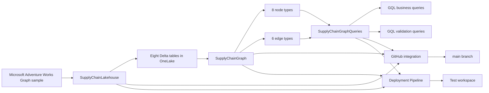
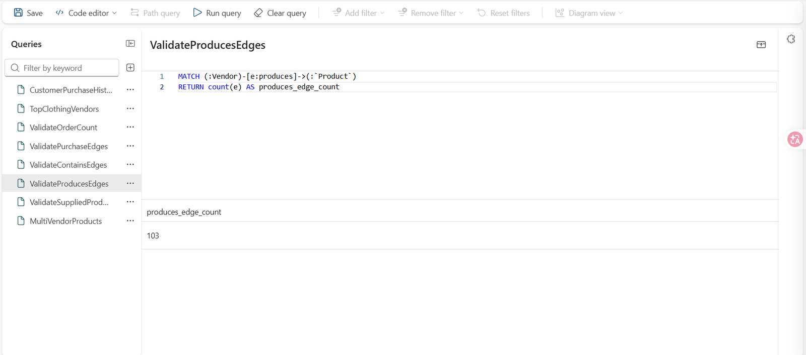
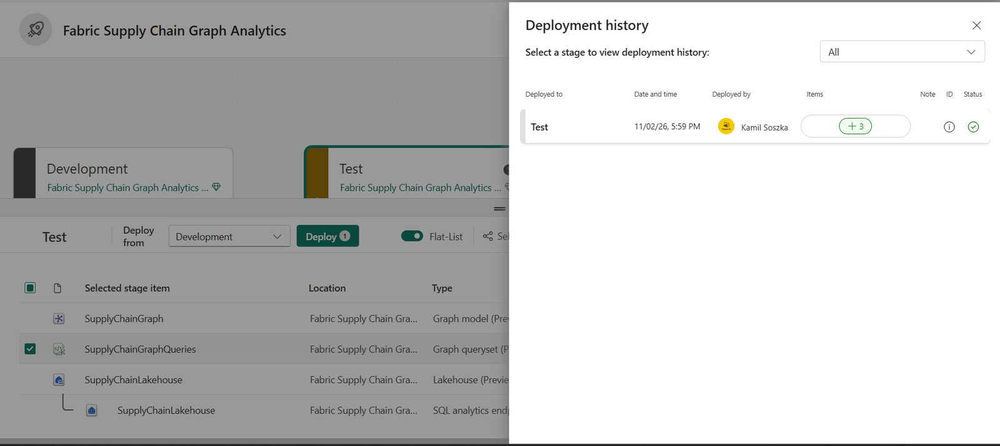

# Fabric Supply Chain Graph Analytics

[](https://www.microsoft.com/microsoft-fabric)
[](https://learn.microsoft.com/fabric/graph/overview)
[](https://learn.microsoft.com/fabric/graph/gql-language-guide)
[](LICENSE)

A portfolio project demonstrating relationship-centric supply chain analytics in Microsoft Fabric. The solution models customers, orders, products, employees, categories, and vendors as a property graph over OneLake data, then uses GQL to analyze multi-hop business relationships.

## Business objectives

The project answers relationship-oriented questions that are cumbersome to express and explore in a purely tabular model:

- Which products did a specific customer purchase?
- Which vendors supply products with the highest order activity in a selected category?
- Which products depend on multiple vendors?
- Are all source rows represented by valid graph nodes and edges?
- Can the graph solution be versioned in GitHub and promoted from Development to Test?

## Architecture



## Fabric items

- `SupplyChainLakehouse`: OneLake storage and eight source tables.
- `SupplyChainGraph`: graph model with eight node types and six edge types.
- `SupplyChainGraphQueries`: saved business and validation queries.
- Deployment Pipeline: two stages, Development and Test.
- GitHub integration: workspace definitions synchronized to the `main` branch.

## Data model

### Node types

| Node | Source table | Key |
|---|---|---|
| Customer | `adventureworks_customers` | `CustomerID_K` |
| Employee | `adventureworks_employees` | `EmployeeID_K` |
| Order | `adventureworks_orders` | `SalesOrderDetailID_K` |
| ProductCategory | `adventureworks_productcategories` | `CategoryID_K` |
| Product | `adventureworks_products` | `ProductID_K` |
| ProductSubcategory | `adventureworks_productsubcategories` | `SubcategoryID_K` |
| VendorProduct | `adventureworks_vendorproduct` | `ProductID_FK` |
| Vendor | `adventureworks_vendors` | `VendorID_K` |

### Edge types

| Edge | Relationship | Source table |
|---|---|---|
| `sells` | Employee -> Order | `adventureworks_orders` |
| `purchases` | Customer -> Order | `adventureworks_orders` |
| `contains` | Order -> Product | `adventureworks_orders` |
| `isOfType` | Product -> ProductSubcategory | `adventureworks_products` |
| `belongsTo` | ProductSubcategory -> ProductCategory | `adventureworks_productsubcategories` |
| `produces` | Vendor -> Product | `adventureworks_vendorproduct` |


## Saved GQL queries

### Business analysis

- `CustomerPurchaseHistory`: traverses Customer -> Order -> Product for a selected customer.
- `TopClothingVendors`: ranks vendors and product subcategories by order activity in the Clothing category.
- `MultiVendorProducts`: identifies products supplied by more than one vendor.

### Validation

- `ValidateOrderCount`
- `ValidatePurchaseEdges`
- `ValidateContainsEdges`
- `ValidateProducesEdges`
- `ValidateSuppliedProducts`

## Example business query

```gql
MATCH (v:Vendor)-[:produces]->(p:`Product`)->(sc:`ProductSubcategory`)->(c:`ProductCategory`),
      (o:`Order`)-[:`contains`]->(p)
FILTER c.categoryName = 'Clothing'
LET vendorName = v.vendorName, subCategoryName = sc.subCategoryName
RETURN vendorName, subCategoryName, count(DISTINCT p) AS num_products, count(o) AS num_orders
GROUP BY vendorName, subCategoryName
ORDER BY num_orders DESC
LIMIT 5
```


## Validation results

| Check | Expected | Result | Status |
|---|---:|---:|---|
| Source tables loaded | 8 | 8 | Passed |
| Order nodes | 60,919 | 60,919 | Passed |
| `purchases` edges | 60,919 | 60,919 | Passed |
| `contains` edges | 60,919 | 60,919 | Passed |
| `produces` edges | 103 fully matched relationships | 103 | Passed |
| Distinct supplied products | 83 | 83 | Passed |
| Deployment to Test | 3 Fabric items | 3 | Passed |

## Data-quality finding

The `adventureworks_vendorproduct` source contains 460 distinct vendor-product pairs and no null vendor or product keys. However, only 103 rows match both an existing Vendor node and an existing Product node:

- matched vendor keys: 460
- matched product keys: 103
- fully matched graph edges: 103
- missing product matches: 357

The graph therefore creates 103 valid `produces` edges. This is expected behavior because an edge cannot be materialized without both endpoint nodes. The result is retained as an explicit data-quality finding rather than hidden or artificially corrected.

```gql
MATCH (:Vendor)-[e:produces]->(:`Product`)
RETURN count(e) AS produces_edge_count
```



## CI/CD

### Git integration

The Development workspace is connected to this GitHub repository. The following supported definitions are synchronized:

- `SupplyChainGraph.GraphModel`
- `SupplyChainGraphQueries.GraphQuerySet`
- `SupplyChainLakehouse.Lakehouse`

Data stored in OneLake, execution history, credentials, and secrets are not stored in Git.

### Deployment Pipeline

The pipeline contains two stages:

1. Development
2. Test

The three Fabric items were successfully deployed to Test. Post-deployment validation returned:

- `ValidateOrderCount`: 60,919
- `ValidateProducesEdges`: 103
- `ValidateSuppliedProducts`: 83

The deployed QuerySet references the environment-specific Graph model identifier in Test. Therefore, its dependency object ID differs from Development even when the query content is unchanged.



## Repository structure

```text
.
├── SupplyChainGraph.GraphModel/
├── SupplyChainGraphQueries.GraphQuerySet/
├── SupplyChainLakehouse.Lakehouse/
├── docs/
│   ├── OPERATIONS.md
│   ├── RESTORE.md
│   ├── VALIDATION.sql
│   └── screenshots/
│       ├── deployment-history-success.png
│       ├── graph-model-nodes-edges.png
│       ├── top-clothing-vendors-results.png
│       └── validate-produces-edges.png
├── LICENSE
└── README.md
```

## Trial and Preview limitations

- The project was built on Microsoft Fabric Trial and does not require an Azure subscription or paid external services.
- Graph availability depends on the Fabric capacity region.
- The Fabric interface used during this project marked Graph Model, Graph QuerySet, and Lakehouse support in Deployment Pipelines as Preview.
- Graph model changes require a save and full graph reload; structural changes are not applied incrementally.
- Fabric Git integration versions supported item definitions, not OneLake data or execution history.
- Deployment can create environment-specific dependency identifiers.
- When the Trial expires, Fabric items require assignment to an eligible capacity to remain active.

## Security

- No tokens, passwords, credentials, or connection secrets are stored in the repository.
- GitHub access uses a fine-grained personal access token scoped to this repository with only `Contents: Read and write` permission.
- Screenshots were reviewed to exclude token values and private connection data.
- The sample contains fictional demonstration data supplied by Microsoft.

## Documentation

- [`docs/RESTORE.md`](docs/RESTORE.md): safe restoration procedure.
- [`docs/VALIDATION.sql`](docs/VALIDATION.sql): source-table and relationship validation.
- [`docs/OPERATIONS.md`](docs/OPERATIONS.md): operating, refreshing, validating, and troubleshooting the solution.

## Source dataset

The project uses Microsoft's Adventure Works dataset prepared specifically for the Fabric Graph tutorial:

- [Fabric Graph tutorial](https://learn.microsoft.com/fabric/graph/tutorial-introduction)
- [Microsoft Fabric samples repository](https://github.com/microsoft/fabric-samples/tree/main/docs-samples/graph)

## License

This project is licensed under the [MIT License](LICENSE).
